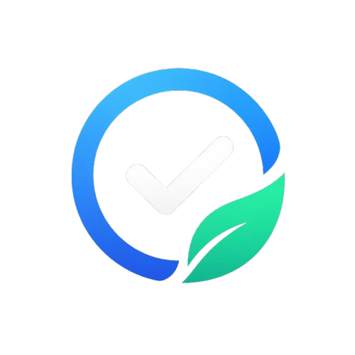
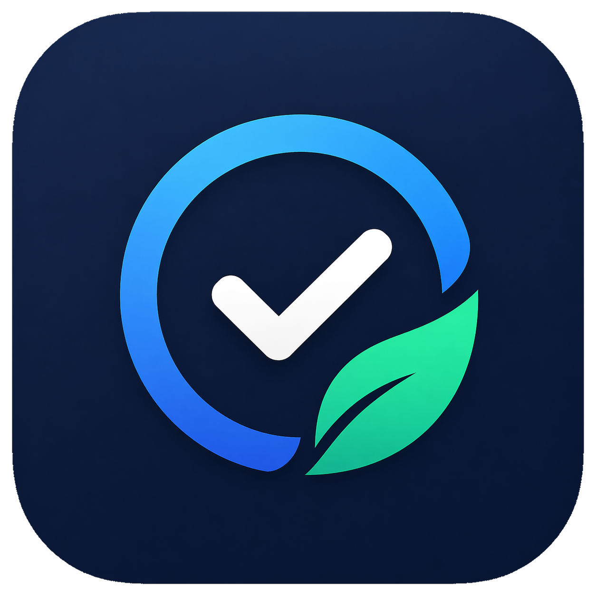

<div align="center">


# TrackMate

**Personal Productivity, Habit Building & Expense Intelligence — Completely Offline**

*A mindful, unified companion for Android designed to help you build lasting routines, understand your spending, safeguard private notes, and remember life's milestones with zero cloud dependency.*

[](https://github.com/YOUR_USERNAME/TrackMate/releases/latest)
[](https://flutter.dev)
[](#offline-architecture--privacy-first)
[](LICENSE)

<br/>

<a href="https://github.com/YOUR_USERNAME/TrackMate/releases/latest">
  
</a>
&nbsp;&nbsp;
<a href="#core-capabilities">
  
</a>
&nbsp;&nbsp;
<a href="#quick-start--installation">
  
</a>

<br/><br/>



</div>

---

## Executive Summary

Modern mobile productivity is often fragmented across multiple subscription apps that require permanent internet connectivity, cloud accounts, and invasive analytics.

**TrackMate** unifies your essential daily productivity systems into a single, high-performance Flutter mobile application that operates **100% offline**:

1. **Habit Engine**: Daily tracking, completion rings, weekly matrices, and streak analytics.
2. **Expense Intelligence**: Dual-tier logging (Food vs. Extra), annual rollovers, multi-year history, and vector PDF exports.
3. **Digital Notebook & Checklists**: Color-coded categorization, markdown checklists, and recycle bin safeguards.
4. **PIN-Protected Secret Vault**: Dedicated private notes and credentials manager locked behind a local 4-digit PIN.
5. **Date Tracker**: Birthday and anniversary alerts with milestone countdowns, celebratory visual accents, and scheduled system notifications.
6. **Focus Stopwatch & Ambient Audio**: Deep focus timer paired with 6 offline binaural and nature soundscapes.

---

## Why Choose TrackMate?

<table>
  <tr>
    <td width="50%" valign="top">
      <h3>🛡️ 100% Offline & Private</h3>
      <p>Your habits, finances, credentials, and personal notes never leave your smartphone. TrackMate runs without accounts, internet access, or remote analytics.</p>
    </td>
    <td width="50%" valign="top">
      <h3>🎯 Habit Consistency Engine</h3>
      <p>Transform daily ambitions into automatic routines. Visualize your consistency with streak counters, weekly progress rings, and historical analytics.</p>
    </td>
  </tr>
  <tr>
    <td width="50%" valign="top">
      <h3>💰 Dual-Tier Expense Tracking</h3>
      <p>Distinguish between daily food sustenance and discretionary extra expenses. Navigate consecutive years automatically with permanent archived history.</p>
    </td>
    <td width="50%" valign="top">
      <h3>🔒 Hardware-Local Secret Vault</h3>
      <p>Keep sensitive notes and credentials isolated from regular notes. Protected by an on-screen numpad lock with hashed local authentication.</p>
    </td>
  </tr>
</table>

---

## Core Capabilities

### 1. Habit Tracker & Consistency Engine

Track daily commitments, celebrate unbroken streaks, and gain meaningful insight into your personal discipline over time.

* **Daily & Scheduled Frequencies**: Configure habits for everyday execution or targeted weekdays.
* **Streak & Completion Metrics**: Real-time current streak indicators (🔥), personal best records, and percentage-based completion rings.
* **Analytical Review**: Review weekly grids and monthly trends to pinpoint routine lapses and peak productivity days.
* **Recycle Bin Protection**: Accidentally deleted habits remain recoverable from the Activity Log recycle bin.

<table>
  <tr>
    <td align="center" width="50%">
      <br/>
      <em>Daily Habit Routines & Progress Rings</em>
    </td>
    <td align="center" width="50%">
      <br/>
      <em>Weekly & Monthly Consistency Analytics</em>
    </td>
  </tr>
</table>

---

### 2. Expense Tracker & Financial Intelligence

Take full control over personal cash flow with a structured, two-tier logging system designed for everyday financial awareness.

* **Two-Tier Expenditure System**:
  * **Food Expenses**: Quick daily sustenance tracking with instant sum calculations.
  * **Extra Expenses**: Itemized discretionary purchases with category titles, numeric amounts, and custom notes.
* **Automatic Year Rollover**: Intelligently detects the calendar year (2026, 2027, and beyond) while permanently preserving past years' archives.
* **Analytical Dual-Line Graph**: Side-by-side comparison of Food vs. Extra spending with clean, rounded monetary Y-axis intervals (e.g. 500, 1,000, 2,500, 5,000).
* **Vector PDF Generation**: Multi-page report generation including a yearly summary header, spending trend chart, 12-month breakdown table, and daily itemized logs.

<table>
  <tr>
    <td align="center" width="50%">
      <br/>
      <em>Annual Spending Overview & Breakdown</em>
    </td>
    <td align="center" width="50%">
      <br/>
      <em>Interactive Spending Analytics & Trends</em>
    </td>
  </tr>
</table>

---

### 3. Digital Notes & Interactive Checklists

A flexible, lightweight digital notebook designed for quick thought capture, work projects, and recurring checklists.

* **Color-Coded Categories**: Organize thoughts across Personal, Study, Work, Ideas, Health, or custom tags.
* **Interactive Task Mode**: Toggle standard notes into interactive checklists with one-tap completion.
* **Pinned Notes**: Keep high-priority reminders anchored to the top of your workspace.
* **Trash Recovery**: Restore discarded notes seamlessly via the built-in note recovery screen.

<table>
  <tr>
    <td align="center" width="50%">
      <br/>
      <em>Categorized Personal Digital Notes</em>
    </td>
    <td align="center" width="50%">
      <br/>
      <em>Interactive Checklists & Action Items</em>
    </td>
  </tr>
</table>

---

### 4. Secret Notes & Credentials Vault

A dedicated, isolated vault for sensitive information that requires strict privacy and authentication.

* **4-Digit PIN Security**: Gated by a custom on-screen numeric keypad; hashed and verified entirely on-device.
* **Change PIN Facility**: Secure workflow requiring verification of the existing PIN before updating credentials.
* **Password Manager**: Store account identifiers, login usernames, passwords, and service URLs with single-tap clipboard copy and visibility toggles.
* **Complete Isolation**: Vault entries are segregated from regular notes and excluded from unauthenticated views.

<table>
  <tr>
    <td align="center" width="50%">
      <br/>
      <em>PIN Security Lock Screen</em>
    </td>
    <td align="center" width="50%">
      <br/>
      <em>Encrypted Local Credentials & Vault</em>
    </td>
  </tr>
</table>

---

### 5. Date Tracker & Milestone Reminders

Never miss an important life event. Track birthdays, anniversaries, and milestones with dynamic countdowns and visual alerts.

* **Event Categories**: Dedicated classification for Birthdays (🎂), Anniversaries (🥂), and Milestones (📅).
* **Dynamic Time Engine**: Automatically calculates upcoming occurrences, milestone years, or days elapsed.
* **Celebratory Visual Hierarchy**:
  * **Today**: Vibrant ruby-rose accent border, warm celebratory glow, and festive blush background.
  * **Tomorrow**: Calm sky-blue accent border with soft oceanic tinting.
* **In-App Marquee & System Alarms**: Auto-scrolling title display prevents text truncation, complemented by scheduled Android alarm notifications.

<table>
  <tr>
    <td align="center" width="50%">
      <br/>
      <em>Upcoming Events & Milestone Badges</em>
    </td>
    <td align="center" width="50%">
      <br/>
      <em>Today & Tomorrow Celebratory Alerts</em>
    </td>
  </tr>
</table>

---

### 6. Focus Stopwatch & Offline Ambient Audio

Enhance deep work sessions with a built-in focus timer supported by native, offline ambient soundscapes.

* **Integrated Stopwatch**: Clean, non-intrusive focus timer to track study sessions and work blocks.
* **Offline Audio Soundscapes**: 6 embedded audio environments that require zero network streaming:
  * 🌲 *Calm Forest Nature*
  * 🧠 *Focus Binaural 40Hz*
  * 🍃 *Forest ASMR Break*
  * 🧘 *Meditation Earth Resonance*
  * 🕊️ *Overthinking Relief*
  * 🌧️ *Rain & Thunderstorm Focus*

---

## Offline Architecture & Privacy First

> [!IMPORTANT]
> **TrackMate does not have a backend server, cloud database, or third-party tracking SDK.**

* **Local-First Storage**: All application data is persisted directly to internal device storage using hardened SharedPreferences and local key-value stores.
* **Zero Telemetry**: No tracking identifiers, device fingerprints, or advertising beacons exist within the application.
* **Portable Encrypted Backup**: Generate an encrypted JSON archive of all your habits, expenses, notes, and dates directly to your local file system, allowing effortless migration between devices.

---

## The Journey Behind TrackMate

TrackMate represents **4 to 6 months of dedicated personal engineering**, beginning as an academic project in Semester 6 and evolving through rigorous iterations across subsequent terms and academic breaks.

Frustrated by fragmented mobile apps that enforce monthly subscriptions and cloud dependencies for basic productivity, TrackMate was built to provide a cohesive, aesthetic, and completely offline alternative. Every screen, animation curve, custom painter, and data model was crafted to balance responsiveness, visual elegance, and uncompromising privacy.

---

## Quick Start & Installation

Install the official pre-compiled Android package in a few straightforward steps:

```markdown
1. Navigate to the GitHub Releases page:
   https://github.com/YOUR_USERNAME/TrackMate/releases/latest

2. Download the latest release file: app-debug.apk (or trackmate-v1.0.apk)

3. Tap the downloaded APK file on your Android smartphone.

4. If prompted, permit your browser or file manager to install packages from this source.

5. Open TrackMate and personalize your local profile name to begin.
```

---

## Technology Stack

* **Platform**: Android (API Level 21+)
* **Framework**: Flutter & Dart
* **Design Philosophy**: Custom Material 3 with Poppins Typography
* **State Management**: Reactive Provider Pattern
* **Document Engine**: Vector-based PDF generation (`pdf` & `printing`)
* **Audio Engine**: Embedded local asset playback (`audioplayers`)
* **Persistence**: Local device storage (`shared_preferences`)

---

## Verification & Transparency

| Module | Verification Status | Storage Mode |
| :--- | :---: | :--- |
| **Habit Tracker** | ✅ Verified | 100% Local Device Storage |
| **Expense Tracker** | ✅ Verified | 100% Local Device Storage |
| **Expense PDF Export** | ✅ Verified | Native Device Vector Rendering |
| **Digital Notes & Tasks** | ✅ Verified | 100% Local Device Storage |
| **PIN Secret Notes** | ✅ Verified | 100% Local (Hashed Authentication) |
| **Password Manager** | ✅ Verified | 100% Local Device Storage |
| **Date Tracker** | ✅ Verified | Local SQLite / Preferences |
| **Scheduled Alarms** | ✅ Verified | Android AlarmManager / Notifications |
| **Ambient Soundscapes** | ✅ Verified | Embedded Offline Audio Assets |
| **Local Backup/Restore**| ✅ Verified | Local JSON File Export |
| **Cloud Authentication**| ❌ Excluded | Intentionally Offline-First (No Google/Firebase Auth) |

---

<div align="center">

**TrackMate** — Take control of your habits, finances, and life routines.

[**Download Latest Release**](https://github.com/YOUR_USERNAME/TrackMate/releases/latest) • [**Report an Issue**](https://github.com/YOUR_USERNAME/TrackMate/issues)

</div>

