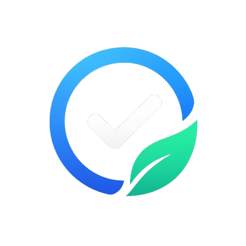
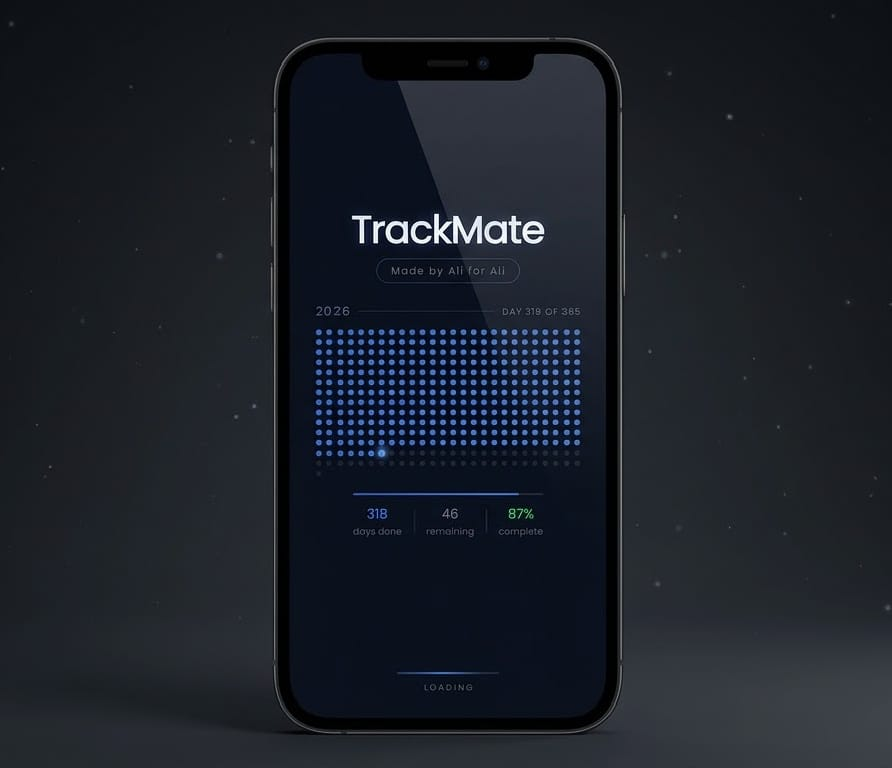
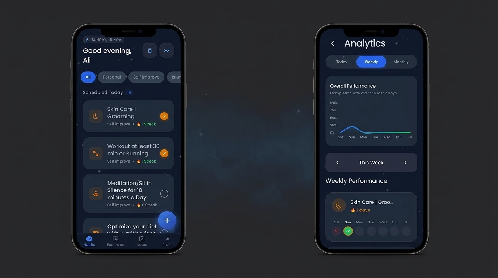
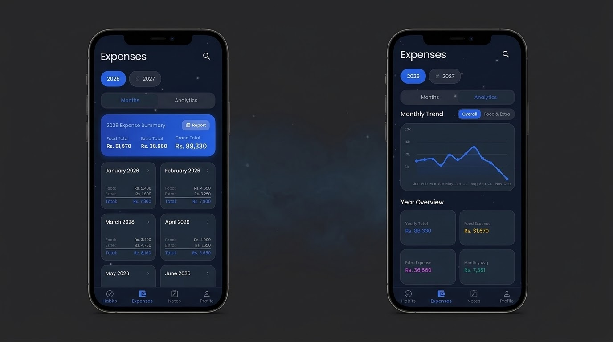
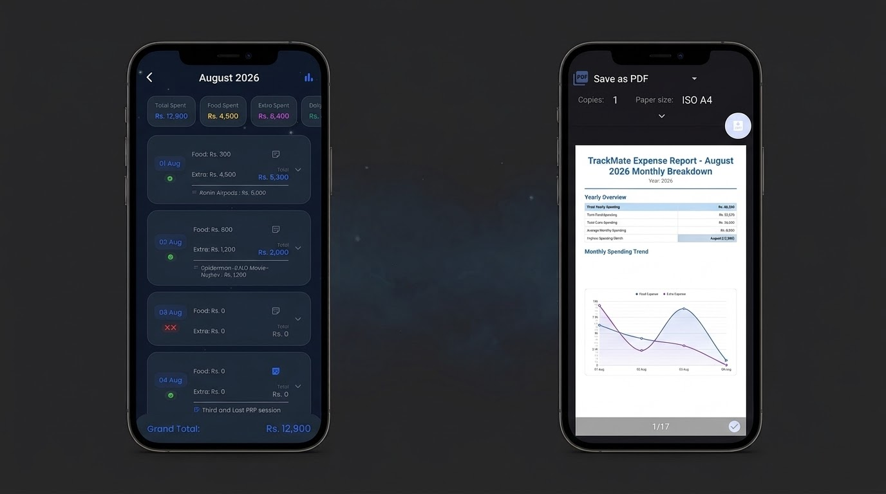
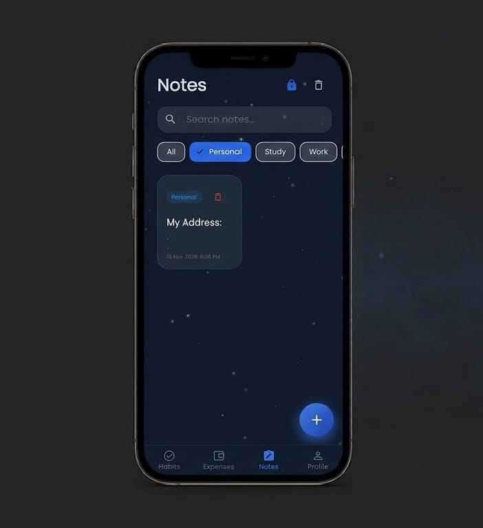
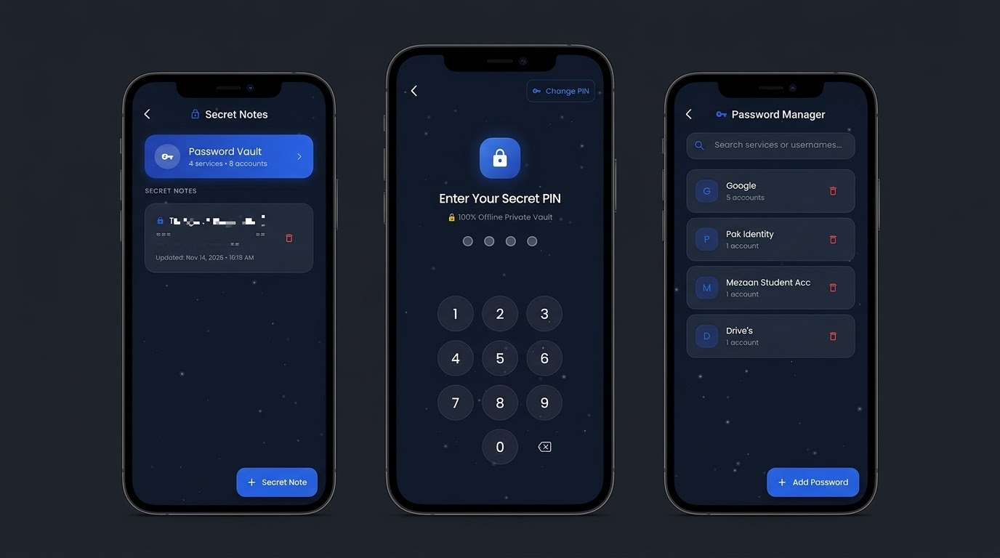
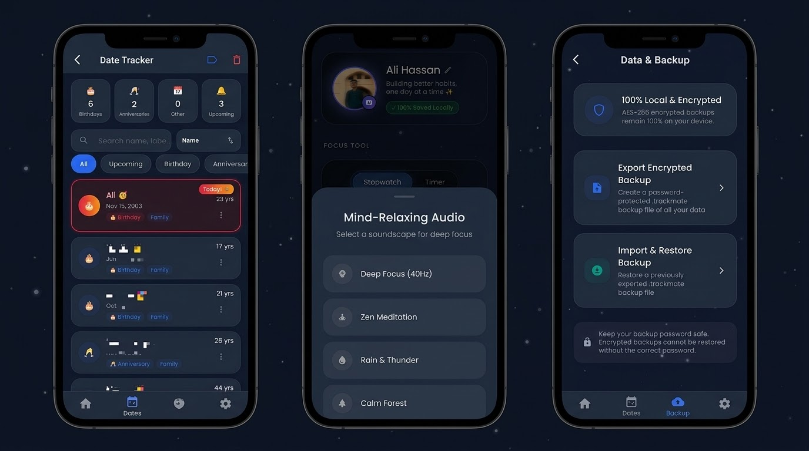

# TrackMate — Offline Personal Life & Productivity Suite

  

  <h1>TrackMate</h1>
  <h3>Your habits, expenses, notes and important moments — in one place.</h3>
  
<strong>A personal productivity companion for Android, designed around local storage and offline convenience.</strong>

  

    
    &nbsp;
    
    &nbsp;
    
  

  

    
    
    
  

---

## About TrackMate

TrackMate brings several everyday organization tools together in one Android application. Instead of switching between separate apps to manage routines, spending, notes, passwords and important dates, you can keep these personal tools together in one place.

The focus is practical: make it easier to build consistent habits, understand where your money goes, keep useful information organized, and remember the moments that matter.

TrackMate is built with **Flutter** and is designed around **local, offline use**. Its core personal records are stored on the device, so supported features remain useful without a constant internet connection.

> **One app for the little things that make everyday life easier to manage.**

## Why TrackMate?

<table>
  <tr>
    <td width="50%" valign="top">
      <h3>🧭 Less app switching</h3>
      
Habits, expenses, notes, private information, dates and focus tools are brought together in one personal workspace.

    </td>
    <td width="50%" valign="top">
      <h3>📴 Offline-friendly by design</h3>
      
Use supported features and access locally saved information without depending on a continuous internet connection.

    </td>
  </tr>
  <tr>
    <td width="50%" valign="top">
      <h3>📈 See your progress</h3>
      
Weekly and monthly habit views help turn a list of intentions into a clearer picture of your consistency over time.

    </td>
    <td width="50%" valign="top">
      <h3>🗂️ Keep information organized</h3>
      
Save everyday notes, track expenses, store important dates and keep selected private information in dedicated areas.

    </td>
  </tr>
  <tr>
    <td width="50%" valign="top">
      <h3>📄 Take your records further</h3>
      
Generate PDF reports for supported expense and habit information, making your progress easier to review and keep.

    </td>
    <td width="50%" valign="top">
      <h3>🎧 Make room for focus</h3>
      
Use the built-in focus timer and included ambient soundscapes to support study, work or a quiet break.

    </td>
  </tr>
</table>

   

  <h2>✨ Meet TrackMate</h2>
  
From the first splash screen to your everyday productivity workspace.

  

## Features

### 1. Habit Tracker — build consistency, one day at a time

TrackMate's habit area helps you create routines and see how consistently you follow them. Set up habits around your schedule, mark them as complete, and use the progress views to understand how you are doing.

- **Daily and scheduled habits:** Set up everyday routines or choose specific days.
- **Progress at a glance:** Review completion indicators and progress rings.
- **Streak tracking:** Keep an eye on your current streak and personal best.
- **Weekly and monthly reviews:** Look back at your activity, spot missed days and review your consistency.
- **Activity and recovery:** Where available, use the activity/recycle-bin flow to review or recover deleted habit records.

  
  
<em>Habit dashboard, daily tracking and related progress views.</em>

### 2. Expense Tracker — understand your spending

The expense tracker gives everyday spending a clear structure. TrackMate separates food spending from other expenses, helping you review routine costs as well as additional purchases.

- **Food expenses:** Record everyday food-related spending and see the running totals.
- **Extra expenses:** Add other purchases with details such as a title, amount and note.
- **Monthly and yearly views:** Review records by month and move between years while keeping previous records available.
- **Spending analytics:** Compare spending categories and review the available charts and summaries.
- **PDF reports:** Generate a shareable, printable report from supported expense records.

  
  
<em>Expense records, spending overview and analytics.</em>

### 3. Monthly Insights & PDF Reports — review the bigger picture

A quick daily check-in is useful, but looking back over a full month can reveal patterns that are easy to miss. TrackMate's monthly views help you review your habit activity over a wider period.

Where supported, you can also generate a PDF report to keep a separate copy of your progress or review it outside the app.

- Review a selected month's habit activity.
- See completion and consistency information in a broader view.
- Generate a PDF report from the available report screen.
- Keep a convenient record for personal review.

  
  
<em>Monthly habit review alongside an example of the generated PDF report.</em>

### 4. Notes — a simple place to save your thoughts

Use the regular Notes area as a lightweight digital notebook for information you want to keep close at hand. It can be useful for study points, quick reminders, ideas, lists and everyday reference notes.

- Create and save personal notes.
- Keep information together instead of scattering it across different apps.
- Use available note organization and editing options to manage your content.
- Revisit saved notes whenever you need them.

  
  
<em>Regular Notes — quick capture for everyday information.</em>

### 5. Private Notes & Password Manager — keep selected information separate

TrackMate also includes a dedicated private area protected by a PIN entry screen. This is separate from the regular Notes experience and is intended for information that users do not want mixed into their everyday notes.

The related password manager provides a place to organize saved account details.

- **PIN access:** Enter the configured PIN to access the private area.
- **Private notes:** Keep selected personal information separate from regular notes.
- **Password manager:** Organize saved credentials and related account details.
- **Convenient access:** Use the available visibility and copy controls where provided.

  
  
<em>Private-area access, secret notes and password management.</em>

> **Privacy reminder:** A PIN-protected screen is an access-control feature; it should not be treated as a guarantee that every saved item is encrypted. Use a unique device PIN and avoid storing information whose exposure could put you at risk.

### 6. Date Tracker — remember the moments that matter

Keep track of birthdays, anniversaries and other meaningful dates. The date tracker helps you see what is coming up and how far away an event is.

- Save important dates and event details.
- Review upcoming occasions and countdowns.
- Keep birthdays, anniversaries and personal milestones in one place.
- Use available reminders/notifications to help you remember selected events.

### 7. Focus Timer & Relaxing Audio — make space to concentrate

When it is time to study, work or take a breather, TrackMate brings a focus timer and a selection of included ambient audio into the same app.

- Use the built-in timer to structure a focus session.
- Choose from the included ambient sound options.
- Enjoy supported soundscapes without needing to stream them online.

### 8. Data & Backup — keep a backup of your information

A backup is useful when moving to another compatible device or keeping an extra copy of important records. TrackMate includes a data and backup area for the available export and restore workflow.

- Create a backup using the in-app options.
- Keep the resulting backup file somewhere safe.
- Use the restore option when you need to bring supported records back.

  
  
<em>Date tracking, ambient audio and the Data & Backup area.</em>

---

## Offline-first experience

TrackMate is designed to keep supported personal productivity features useful without requiring a constant internet connection.

That means you can use the app for locally available records such as habits, expenses and notes while offline. Included ambient audio can also be played without online streaming.

A few things are worth keeping in mind:

- Offline availability depends on the feature and the data already stored on the device.
- Notifications depend on Android permissions and device settings.
- Backup files should be stored safely by the user; uninstalling an app or changing devices may affect locally stored data.
- Keep a separate backup before removing the app or resetting your phone.

## Quick Start — download and install

1. Open the [latest TrackMate release](https://github.com/alihassanazad8245/TrackMate/releases/latest).
2. Download the APK attached to the release.
3. Open the downloaded APK on your Android phone.
4. If Android asks, allow your browser or file manager to install apps from that source.
5. Complete the installation and open TrackMate.

## Built with

TrackMate is an Android application built with **Flutter**. The app brings together its productivity tools in one mobile interface, with local storage and offline use as key design considerations.

## The journey behind TrackMate

TrackMate represents around **four to six months of development and ongoing refinement**. It began as a Semester 6 academic project and continued to receive attention and improvements during the following semester and available study breaks.

What started as an academic project grew into a broader personal productivity app: a place to bring everyday routines, spending, notes and useful personal tools together.

## Contact & project links

Have a question, found an issue, or want to share feedback?

- **GitHub:** [alihassanazad8245](https://github.com/alihassanazad8245)
- **Email:** [ali8245hassan824@gmail.com](mailto:ali8245hassan824@gmail.com)
- **Issues & feedback:** [Open an issue on GitHub](https://github.com/alihassanazad8245/TrackMate/issues)

---

  <h3>TrackMate</h3>
  
<strong>Build better habits. Stay organized. Keep life's details close.</strong>

  <a href="https://github.com/alihassanazad8245/TrackMate/releases/latest">Download the latest APK</a>
    
  Made with care over months of learning, building and improving.

